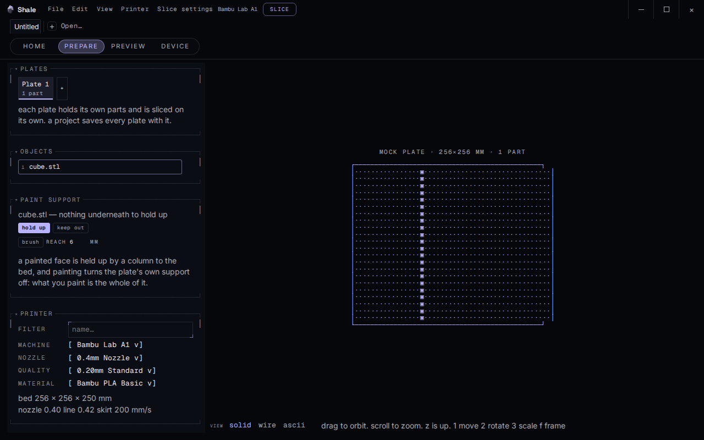

<p>
  
</p>

# Shale

Shale is a **Bambu Lab–focused 3D-printing slicer** built around an unmodified [CuraEngine 5.13](https://github.com/Ultimaker/CuraEngine) process. You get a **Tauri desktop app** for prepare → slice → preview → send, plus a **standalone CLI** (`shale`) and **MCP server** (`shale-mcp`) that drive the same engine without a window.



Version **0.1.3** is the first public release on `main`: Bambu profiles from Bambu Studio, Cura 5.13 resource data, machine-specific start/end G-code, LAN device control, and agent-facing slice tools.

## Download

Pre-built binaries are on GitHub Releases:

**[https://github.com/Alevetto07/Shale/releases/latest](https://github.com/Alevetto07/Shale/releases/latest)**

| Asset | Platform | What it is |
| --- | --- | --- |
| `Shale_0.1.3_x64-setup.exe` | Windows x64 | Desktop installer (per-user NSIS) |
| `shale-0.1.3-windows-x64.zip` | Windows x64 | CLI (`shale.exe`) + MCP (`shale-mcp.exe`) only |
| `shale-0.1.3-linux-x64.tar.gz` | Linux x64 | CLI (`shale`) + MCP (`shale-mcp`) only |

Each release also includes `SHA256SUMS.txt` for the three archives above.

Shale does **not** bundle CuraEngine or printer profile trees in these packages. Point the app or CLI at an installed UltiMaker Cura 5.x / CuraEngine build and at Bambu Studio profiles (or use `scripts/fetch-resources.sh` when building from source). See [docs/INSTALL-CLI.md](docs/INSTALL-CLI.md) for environment variables.

### Windows (desktop installer)

```powershell
# After downloading Shale_0.1.3_x64-setup.exe
.\Shale_0.1.3_x64-setup.exe
```

Install UltiMaker Cura 5.x (for `CuraEngine.exe` and resources) or run `.\scripts\fetch-resources.ps1` from a source checkout and set `SHALE_CURA_DIR` / `SHALE_MATERIALS_DIR`. Bambu printers use an installed Bambu Studio profile tree or `SHALE_ORCA_DIR`.

### Windows (CLI zip)

```powershell
Expand-Archive -Path shale-0.1.3-windows-x64.zip -DestinationPath $env:LOCALAPPDATA\Shale\cli
cd $env:LOCALAPPDATA\Shale\cli
$env:SHALE_CURAENGINE = "C:\Program Files\UltiMaker Cura 5.13\CuraEngine.exe"
$env:SHALE_CURAENGINE_LIB_DIR = "C:\Program Files\UltiMaker Cura 5.13"
$env:SHALE_CURA_DIR = "C:\path\to\vendor\Cura"
$env:SHALE_MATERIALS_DIR = "C:\path\to\vendor\fdm_materials"
$env:SHALE_ORCA_DIR = "C:\path\to\BambuStudio\resources\profiles"
.\shale.exe info
.\shale.exe slice .\model.stl --printer bambu_lab_a1 --quality standard -o .\out.gcode
```

### Linux (CLI tarball)

```bash
tar -xzf shale-0.1.3-linux-x64.tar.gz
cd shale-0.1.3-linux-x64
export SHALE_CURAENGINE=/usr/bin/CuraEngine
export SHALE_CURA_DIR=/usr/share/cura/resources
export SHALE_MATERIALS_DIR=/usr/share/cura/resources/materials
export SHALE_ORCA_DIR=/path/to/BambuStudio/resources/profiles
./shale info
./shale slice ./model.stl --printer bambu_lab_a1 --quality 0.20mm --output ./out.gcode
```

Friendly quality names (`standard`, `fine`, `draft`, `0.20 mm Standard`, and similar) resolve to the correct Bambu process id; unknown values fail with a list of valid processes.

## Quick start — CLI

```bash
shale info                    # paths, engine probe, catalogue size
shale printers --search a1    # Bambu machines in the profile library
shale settings --printer bambu_lab_a1 --quality standard
shale slice model.stl --printer bambu_lab_a1 -o model.gcode
```

Full command reference: [docs/INSTALL-CLI.md](docs/INSTALL-CLI.md).

## Quick start — MCP

Build or unpack `shale-mcp`, then register it with your MCP client.

**Claude Desktop** (`claude_desktop_config.json`):

```json
{
  "mcpServers": {
    "shale": {
      "command": "/absolute/path/to/shale-mcp",
      "env": {
        "SHALE_CURAENGINE": "/absolute/path/to/CuraEngine",
        "SHALE_CURA_DIR": "/absolute/path/to/vendor/Cura",
        "SHALE_MATERIALS_DIR": "/absolute/path/to/vendor/fdm_materials",
        "SHALE_ORCA_DIR": "/absolute/path/to/BambuStudio/resources/profiles"
      }
    }
  }
}
```

**Claude Code** (user or project MCP settings — same shape as above):

```json
{
  "mcpServers": {
    "shale": {
      "type": "stdio",
      "command": "/absolute/path/to/shale-mcp",
      "env": {
        "SHALE_CURAENGINE": "/absolute/path/to/CuraEngine",
        "SHALE_CURA_DIR": "/absolute/path/to/vendor/Cura",
        "SHALE_MATERIALS_DIR": "/absolute/path/to/vendor/fdm_materials",
        "SHALE_ORCA_DIR": "/absolute/path/to/BambuStudio/resources/profiles"
      }
    }
  }
}
```

Optional HTTP mode (loopback only): `shale-mcp --http 127.0.0.1:7337` → `http://127.0.0.1:7337/mcp`.

Tools include `list_printers`, `load_model`, `set_settings`, `slice`, `export_gcode`, support helpers, and custom instructions. See the in-repo MCP section in [docs/INSTALL-CLI.md](docs/INSTALL-CLI.md) and the longer developer notes in [HANDOVER.md](HANDOVER.md).

## Supported printers

v0.1.3 exposes **Bambu Lab machines** (and other vendors present in the Bambu Studio profile library) through `Catalog::selectable_printers()`. Default machine is **Bambu Lab A1** (`bambu_lab_a1`). Typical ids include A1 / A1 mini, P1P / P1S, X1 Carbon, and additional BBL definitions shipped in Bambu Studio—use `shale printers` or the desktop **Printer** menu to see what your profile tree provides.

Creality and other Cura definitions still load for resolution tests, but the product UI and CLI defaults are Bambu-first.

## Build from source

Requirements: **Rust stable** (1.85+), **Node 22**, a C toolchain, and on Linux the GTK/WebKit packages for Tauri (see [docs/WINDOWS-RELEASE.md](docs/WINDOWS-RELEASE.md) for Windows specifics).

```bash
git clone https://github.com/Alevetto07/Shale.git
cd Shale
./scripts/fetch-resources.sh          # Cura 5.13.0 + fdm_materials + Bambu profiles → vendor/
# Build CuraEngine 5.13.0 from source or point at an install:
export SHALE_CURAENGINE=/path/to/CuraEngine
export SHALE_CURA_DIR=$PWD/vendor/Cura
export SHALE_MATERIALS_DIR=$PWD/vendor/fdm_materials
export SHALE_ORCA_DIR=$PWD/vendor/BambuStudio/resources/profiles

cargo test --workspace --locked
cd apps/desktop && npm ci && npm run tauri dev
```

Headless binaries only:

```bash
cargo build --release -p shale-cli -p shale-mcp
./scripts/package-cli.sh      # Linux tarball
# Windows: pwsh scripts/package-cli.ps1
```

CuraEngine build instructions: [CuraEngine wiki](https://github.com/Ultimaker/CuraEngine/wiki/Building-CuraEngine-From-Source) (use tag **5.13.0**).

## Licence and third-party notices

**Shale’s own licence: to be decided.** Alessio has not yet chosen a licence for this repository’s original source. Do not assume you may redistribute or reuse the Shale code until that choice is recorded in [LICENSING.md](LICENSING.md).

Runtime and bundled components keep their own terms:

| Component | Licence | Notes |
| --- | --- | --- |
| [CuraEngine](https://github.com/Ultimaker/CuraEngine) | **AGPL-3.0** | Separate process; not embedded in Shale. If you ship a CuraEngine binary alongside Shale, comply with the AGPL for that binary. |
| [UltiMaker Cura](https://github.com/Ultimaker/Cura) `resources/` (when fetched) | LGPL-3.0 | Data files read at runtime; `scripts/fetch-resources.sh` leaves Cura’s `LICENSE` under `vendor/Cura/`. |
| [Bambu Studio](https://github.com/bambulab/BambuStudio) profiles (when fetched or installed) | **AGPL-3.0** | JSON profile data only; Shale does not link Bambu Studio. |
| [fdm_materials](https://github.com/Ultimaker/fdm_materials) | CC0-1.0 | Material XML used as data. |

The **desktop installer and CLI archives** ship [THIRD-PARTY-NOTICES.md](THIRD-PARTY-NOTICES.md) (Rust/Tauri/Manifold and other linked libraries). They do **not** ship CuraEngine or Bambu profile sources; therefore full AGPL texts for those projects are not duplicated inside the installer. Upstream licence texts:

- CuraEngine: [LICENSE](https://github.com/Ultimaker/CuraEngine/blob/5.13.0/LICENSE)
- Bambu Studio: [LICENSE](https://github.com/bambulab/BambuStudio/blob/master/LICENSE)

See [THIRD_PARTY_NOTICES/README.md](THIRD_PARTY_NOTICES/README.md) and [LICENSING.md](LICENSING.md) for detail.

## More documentation

- [docs/INSTALL-CLI.md](docs/INSTALL-CLI.md) — environment variables and headless install
- [docs/WINDOWS-RELEASE.md](docs/WINDOWS-RELEASE.md) — Windows installer build
- [docs/printer-host.md](docs/printer-host.md) — LAN device control
- [LICENSING.md](LICENSING.md) — licensing notes for dependencies