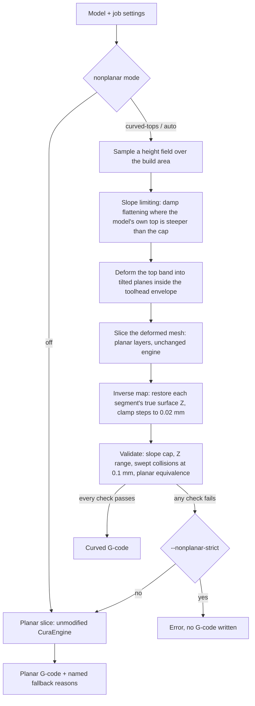

# Non-planar slicing

<!-- SPDX-License-Identifier: AGPL-3.0-or-later -->

Non-planar slicing prints the top of a part along its real surface instead of
stair-stepping it. Shale does this without forking or patching the slicer:
the model is deformed, sliced by an unmodified CuraEngine, and the resulting
G-code is mapped back onto the true surface. Every layer CuraEngine sees is
still planar, which is why the engine's own toolpaths, ordering and cooling
logic keep working unchanged.

The curved pass is never trusted blindly. It runs a verification pass — slope
cap, Z range, swept collisions, planar equivalence — and if any check fails the
job falls back to the planar G-code it already sliced, naming the reason in the
report.

## How it works



1. **Height field.** The build area is sampled on a 0.35 mm grid
   (`grid_step_mm`); each cell stores the top surface height and its gradient.
2. **Slope limiting.** A local top steeper than the cap cannot be flattened
   without dragging the nozzle through the part, so the flattening *strength* is
   damped per cell instead. Up to 24 passes (`MAX_SLOPE_LIMIT_PASSES`) reduce the
   strength until the level surface fits the cap; the smallest strength left
   anywhere is reported as `min_strength`, and 0.02 (`PLANAR_COLLAPSE_STRENGTH`)
   means that cell has been given up and stays planar.
3. **Deformation.** The top band (thickness derived from layer height, with a
   ramp below it) is replaced by a surface that is a plane inside the cap. The
   result is a watertight mesh whose top is printable with planar layers.
4. **Slice.** CuraEngine slices that mesh with the job's normal profile. This is
   the vendor engine, unmodified: no engine parameters are invented for the
   curved pass.
5. **Inverse map.** The G-code's XY is kept and each segment's Z is moved to the
   height of the *true* surface above that point. A segment whose correction
   would exceed 0.02 mm is clamped and counted (`unclamped_excess`); three
   inverse-map exits are named in the fallback reasons.
6. **Validation.** The mapped G-code is re-checked against the safety rules
   below. Anything unexpected — a toolhead strike, a slope beyond the cap, a
   change below the band floor — fails the check and produces the planar
   baseline instead.

Only the deformed region changes. Moves below the band floor must be identical
to the planar slice in position and extrusion, and that is what the equivalence
check enforces.

## Modes

| Mode | What it does |
| --- | --- |
| `off` | Planar slice. No height field, no deformation, no post-pass, no report. |
| `curved-tops` | Flatten the whole printable top shell into bands inside the cap. Best for a part that is dominated by one large curved top. |
| `auto` | Detect curved tops and tilted overhang bands, then enable a band per surface only where the envelope allows it. Surfaces it refuses are reported with the reason. |
| `strict` | Not a mode: a flag that turns the planar fallback into an error. Use it when a planar result is not acceptable and you would rather fail than print something flatter than asked. |

Spellings accepted by the CLI and the MCP tools: `off`, `none`, `curved-tops`,
`curved_tops`, `curvedtops`, `auto`, `automatic` (case-insensitive). Through
the MCP tools an unknown or empty mode is an error, not a silent `off`.

## Supported printers and toolhead envelopes

A curved move only makes sense if the rest of the toolhead clears the part; the
nozzle tip is not the widest thing on the head. Shale ships a swept silhouette
per printer in `crates/shale-nonplanar/data/*_head.json`: nozzle taper, heater
block and silicone sock column, and the part-cooling duct, expressed as
"radius at height above the tip".

| Printer id | Nozzle height | Tip land | Cone half-angle | Body radius | Sock | Duct offsets | Duct height | Horizontal reach |
| --- | --- | --- | --- | --- | --- | --- | --- | --- |
| `bambu_lab_a1` | 4.76 mm | 0.30 mm | 17.5° | 12.0 mm | 4.5 mm / 6.5 mm | 8 / 26 mm | 6.0 mm | 26 mm |
| `bambu_lab_a1_mini` | 4.76 mm | 0.30 mm | 17.5° | 12.0 mm | 4.5 mm / 6.5 mm | 8 / 26 mm | 6.0 mm | 26 mm |
| `bambu_lab_p1p` | 5.20 mm | 0.35 mm | 17.5° | 14.0 mm | 5.0 mm / 7.0 mm | 10 / 32 mm | 7.0 mm | 32 mm |
| `bambu_lab_p1s` | 5.20 mm | 0.35 mm | 17.5° | 14.0 mm | 5.0 mm / 7.0 mm | 10 / 32 mm | 7.0 mm | 32 mm |
| `bambu_lab_x1_carbon` | 5.20 mm | 0.35 mm | 17.5° | 14.5 mm | 5.5 mm / 7.5 mm | 12 / 34 mm | 7.5 mm | 34 mm |
| `bambu_lab_h2d` | 5.50 mm | 0.35 mm | 17.5° | 16.0 mm | 5.5 mm / 8.0 mm | 14 / 36 mm | 8.0 mm | 36 mm |

All six are marked `calibrated: true` with `calibration_tier: conservative`, and
each lists the fields still to be measured on real hardware in
`needs_measurement`. The envelope is conservative by construction: the duct is
checked all the way round using the larger of its two offsets, so a hit reported
by Shale is a hit the head *could* make, not necessarily one it will make from
that side.

Any other printer is refused: `check_printer` returns an error naming the
printers that have an envelope. Slicing planar on those printers is always
allowed — the refusal only covers the curved modes, because without an envelope
the collision pass cannot tell whether the head clears the part, and quietly
printing flat would hide the request.

## The 10 degree cap

`default_max_clearance_angle_deg` is 10.0 in every shipped envelope. The MCP
tools refuse a larger angle; the CLI takes `--max-angle` as given, so
`--max-angle 12` produces a job verified against 12.5° — a limit the envelopes
were not measured for. Prefer the default. The number is a geometry result, not
a preference. For the A1 the
part-cooling duct hangs 6.0 mm above the tip and reaches 26 mm out, so a surface
climbing at `a` degrees is at `d * tan(a)` above the tip at horizontal distance
`d`: it touches the duct's underside exactly where `26 * tan(a) = 6.0`, i.e. at
**13.0°**. Every shipped envelope is set to 10° so that the duct, the sock
column and the discretisation error all stay inside the sweep, and so that
nothing is claimed for the fields still listed under `needs_measurement`.
Multiplication is the whole reason one cap covers all six printers: every
shipped envelope works out between 12.3° (P1P/P1S) and 13.0° (A1/A1 mini) by the
same calculation, so 10° is inside all of them and tightest on the A1.

The effective slope cap is `max_angle + SLOPE_CAP_TOLERANCE_DEG` (0.5°), so the
default job verifies against 10.5°: 10° of design slope plus half a degree for
discretisation.

## Safety checks

The curved G-code is accepted only when all of these pass. Every failure is
named; nothing is silently repaired.

* **Slope.** Measured maximum extrusion slope against the effective cap
  (`slope_cap_deg`, `max_extrusion_slope_deg`, `slope_within_cap`).
* **Z range.** Every move must stay inside the printer's Z limit and above the
  bed (`z_within_limits`, `max_z_seen`, `z_limit_mm`).
* **Swept collisions.** Every extruding and travel move is sampled at 0.1 mm and
  tested against the toolhead silhouette against a 0.1 mm printed-height map
  (`collisions_extruding`, `collisions_travel`). The 0.1 mm contact tolerance is
  half a 0.2 mm layer: the nozzle land riding over the neighbouring bead of the
  same curved band is a squish, not a strike. Measured on this build, a 0.3 mm
  tolerance began flagging curved bands at 8° (307 hits) and 10° (2244 of 4600
  extruding moves); at 0.1 mm the same bands are clean up to 12°.
* **Planar equivalence.** Moves below the band floor must match the planar
  baseline (`planar_equivalence`: `planar_moves_below_band`,
  `curved_moves_below_band`, `mismatched_moves`, `first_mismatch`). If the
  deformation leaked into the lower shell, the job fails here.
* **Extrusion continuity.** Extrusion jumps and feed-cap violations are counted
  (`extrusion_jump_count`, `feed_cap_violations`).

`SafetyReport.ok` is the conjunction. A violation carries its kind, a
human-readable detail and the offending line, and the reasons are also repeated
verbatim in `fallback_reasons`.

## The planar fallback

When any check fails and `strict` is off, Shale writes the planar baseline —
the same job, sliced without the curved pass — and records why:

```text
nonplanar auto islands=1 flattened=0 equiv=true fallback=true \
  collisions_extruding=6 collisions_travel=2534
fallback_reason 6 extruding move(s) collide with printed material (tolerance 0.1 mm) | \
  2534 travel move(s) collide with printed material (tolerance 0.1 mm) | \
  3 inverse-map move(s) needed more than the 0.02 mm slope-clamp budget | \
  a curved move leaves the head envelope | ...
```

The job still prints, at planar quality, and the report says so. With
`--nonplanar-strict` the same failure is an error and no G-code is written.

## Why horizontal bridges and cantilevers fall back

Non-planar slicing here tilts *tops*. It cannot make an unsupported horizontal
underside printable: a bridge needs the previous layer to span the gap, and
tilting a band does not create support where there is none. So when `auto`
finds a horizontal underside, it disables that surface and says why in the
planner's own words:

```text
horizontal underside 90.0° — a ±10.0° tilt round-trips to a planar toolpath; bridge printing already spans it
```

The reasoning is arithmetic: a ±`max_angle` tilt applied to a 90° face is undone
by the layer quantisation, so the toolpath comes back planar anyway, while the
bridge already spans the gap. The same test disables a cantilever whose angle no
tilt inside the cap can improve, reporting the measured angle before and after.
What remains is printed planar, with supports if the profile has them.

This is the honest outcome, not a limitation to hide: a fallback that prints is
better than a curved band that drags the nozzle through the part, and the report
always names which surfaces were curved and which were left alone.

## CLI

```bash
shale slice examples/nonplanar-demo.stl \
  --printer bambu_lab_a1 \
  --nonplanar auto \
  --max-angle 10 \
  -o demo-auto.gcode
```

* `--nonplanar <mode>` — `off` (default), `curved-tops`, `auto`.
* `--max-angle <deg>` — default 10, the value the envelopes are calibrated for.
  The CLI parses it as given; the MCP tools refuse anything outside
  `0 < angle <= 10`.
* `--nonplanar-strict` — fail instead of falling back to planar.
* `--printer <id>` — omitted, the catalogue's default printer is used.
* The usual job flags apply: `--layer`, `--infill`, `--supports`, `--material`,
  `--quality`, `--variant`, `--set key=value`.

The CLI prints time, filament and layers, then the non-planar summary:

```text
time     1 h 11 m
filament 7.23 m
layers   80
nonplanar auto islands=1 flattened=0 equiv=true fallback=true collisions_extruding=6 collisions_travel=2534
auto surfaces=1 fallback_planar=false
nonplanar_safety ok=false violations=2540 max_slope=5.99°
```

Slicing for real needs the engine and the resource trees pointed at by
`SHALE_CURAENGINE`, `SHALE_CURAENGINE_LIB_DIR`, `SHALE_CURA_DIR`,
`SHALE_MATERIALS_DIR` and `SHALE_ORCA_DIR`; without them Shale reports that the
catalogue has no printers rather than guessing.

## MCP

The tools follow the same order as the CLI: choose a printer and settings, load
a model, look at the plan, slice.

* `set_settings` accepts `nonplanar_mode` (`off`, `curved-tops`, `auto`),
  `nonplanar_max_angle_deg` and `nonplanar_strict`. Values are validated first:
  an unknown or empty mode, an angle outside `0 < angle <= 10`, or a curved mode
  on a printer without an envelope is an error naming the fix, and nothing is
  applied.
* `get_settings` repeats the job's `nonplanar` block (mode, angle, strict,
  `supported_by_printer`).
* `plan_nonplanar` returns `detected_features`, the `enabled` and `disabled`
  surfaces with kind, tilt, measured angles and the reason for each refusal, and
  `preview_triangles` (the overlay is a UI concern, so only its count is
  returned).
* `slice` and `slice_summary` add a `nonplanar` block to the summary: mode,
  `fallback_to_planar` with `fallback_reasons`, `safety` (the full
  `SafetyReport` with violations quoted up to 12 plus per-kind counts), the
  `auto_plan` surfaces, slope limiting, collision adjustments and notes. For a
  planar job it is `null`.
* `export_gcode` writes the G-code the session last produced.

The `slice` result carries the decisions, not the raw report: the nested
`nonplanar_report` is dropped so a job with thousands of collision hits still
answers in a few kilobytes.

## M1 end-to-end results

Measured on integration commit `ce02df9` (24 November 2026) with the release CLI,
`--max-angle 10`, the default 0.20 mm process per printer and the vendored, unmodified
CuraEngine 5.13. Print time is the CLI's own estimate; worst slope and collisions come
from the CLI's safety report (`nonplanar_safety`, swept at the 0.1 mm tolerance) and
were cross-checked with an independent G-code validator (bounds, slope histogram,
stepped toolhead profile at 0.1 mm). "Fallback" means the planar baseline was written
and the reason was named in the `;SHALE_NONPLANAR` header.

| Part | A1 mini | A1 | P1S | X1C | Planar → auto time | Worst curved slope | Collisions |
| --- | --- | --- | --- | --- | --- | --- | --- |
| `t-wing` | curved | curved | curved | fallback: a curved move leaves the head envelope | 858–863 s → unchanged | 6.34° | 0 / 0 |
| `dome` (24 mm ball) | fallback: 1 move over the 0.02 mm clamp budget | curved | curved | fallback: a curved move leaves the head envelope | 917–920 s → +0–1 s | 7.61° | 0 / 0 |
| `bridge-overhang` | fallback: no printable surface | fallback | fallback | fallback | 1670–1680 s → unchanged | — | — |
| `pillar-beside-dome` | fallback: collisions | fallback: collisions | fallback: collisions | fallback: collisions | 2347–2359 s → unchanged | — | — |
| `nonplanar-demo` lid | fallback: limiter left a 12.7° level surface | fallback | fallback | fallback | 4234–4263 s → unchanged | — | — |

All 40 files pass the independent validator (no out-of-bounds body moves, no
collisions at 0.1 mm), and the CLI's safety report found no Z inversions on the
curved runs. Curved output costs no measurable time or
filament (at most 1 s and 0.0001 m). The curved region itself is small: on the dome
only the cap where the sphere is flatter than about 9° is lifted, so most of the
part prints exactly as planar. The demo lid currently falls back on every printer;
making it print curved is open work (see below).

Extrusion: `E` is rescaled per move by the local layer-thickness ratio of the
deformation (clamped to 0.5–2×). Measured median `E` per millimetre of 3D path is
0.0331 on curved moves against 0.0333 on planar ones, the largest curved value is
0.0484 (1.45× nominal, on the dome's thinnest band layer), and no move exceeds
0.2 mm of filament per millimetre.

Known limitations at this commit:

* **The 0.06 mm seam.** The band floor is anchored between two planar layers, so the
  first band layer can sit up to 0.06 mm into the last planar one at the footprint
  edge. This is an overlap rather than a gap and stays inside the 0.1 mm contact
  tolerance; very short moves (0.1–0.2 mm) at that seam can show apparent slopes of
  up to 26° that are a squish of a few hundredths of a millimetre, not a tilt.
* **P1S, P1P, X1C and H2D head geometry is still unmeasured.** Their envelopes declare
  a 0.35 mm flat tip land against the 0.42 mm line spacing of a 0.4 mm nozzle; the
  values are conservative estimates listed under `needs_measurement` (the A1 and
  A1 mini envelopes are conservative estimates too), and the X1C fallbacks above
  come from its larger envelope.
* **Horizontal bridges and cantilevers print planar** in auto mode: a ±10° tilt of a
  90° underside round-trips to a planar toolpath, so the planner disables those
  surfaces and says why (see above). Underside bands remain available, unverified,
  behind `--nonplanar-underside`.

## What it is not

* Not a slicer fork: the engine is the vendor binary, untouched.
* Not a claim that any surface can be tilted: the envelope, the slope cap and
  the collision sweep bound what is attempted, and the rest prints planar.
* Not calibrated beyond `conservative` on this hardware yet: the envelopes list
  the fields still to be measured, and the 10° cap has margin precisely because
  those measurements are pending.

## Licence

Shale, including the non-planar pipeline and this document, is licensed under the
GNU Affero General Public License v3.0 or later (`AGPL-3.0-or-later`). CuraEngine is
used as an unmodified external binary under its own licence.
